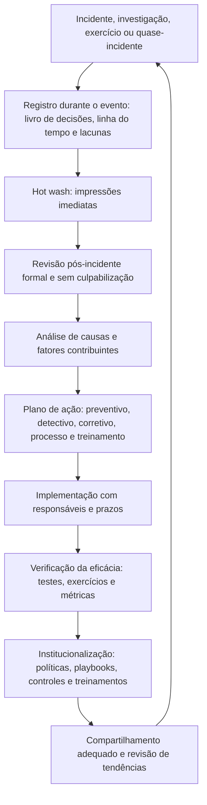

# Fundamentos de Lições Aprendidas e Melhoria Contínua

> **Objetivo pedagógico:** compreender o propósito, o ciclo e as condições de um processo de lições aprendidas em forense digital e resposta a incidentes: o que é uma lição aprendida (e o que não é), quando e como o aprendizado ocorre, quem participa, que insumos e produtos o processo tem, como a cultura de segurança psicológica (justa e sem culpabilização) sustenta a qualidade do aprendizado, como o processo se conecta às normas (NIST, ISO/IEC 27035 e ISO/IEC 27002) e que cuidados jurídicos (sigilo e descoberta de documentos) são necessários.

## 1. O que é uma lição aprendida

Uma **lição aprendida** é um conhecimento obtido da experiência (de um incidente, de uma investigação, de um exercício ou de um quase-incidente) que, ao ser **registrado, analisado e convertido em mudança verificável**, melhora o desempenho futuro. Registrar uma observação sem alterar processos, controles, ferramentas ou treinamento é apenas um **fato observado**, e não uma lição aprendida.

| Conceito | Descrição |
|---|---|
| Observação | O que se notou (por exemplo, "o log de VPN tinha retenção de 30 dias") |
| Lição | O que a observação ensina (por exemplo, "logs de acesso remoto precisam de retenção maior que o tempo típico de permanência do atacante") |
| Ação | A mudança que implementa a lição (por exemplo, "ampliar a retenção para 12 meses até 30/06") |
| Verificação | A evidência de que a ação funcionou (por exemplo, "exportação de 12 meses testada no exercício") |
| Lição **institucionalizada** | Incorporada a políticas, playbooks, controles ou treinamentos |

## 2. Por que o aprendizado é parte da forense

| Razão | Descrição |
|---|---|
| Reduzir a recorrência | Os mesmos erros e lacunas se repetem quando não são tratados |
| Melhorar a qualidade da prova | Lacunas de preservação e de registro são corrigidas |
| Fortalecer a defesa | Detecções e controles passam a cobrir técnicas observadas |
| Demonstrar diligência | Auditores, reguladores e seguradoras valorizam evidências de melhoria |
| Preservar o conhecimento | Evita a dependência de pessoas específicas |
| Calibrar investimentos | Justifica prioridades com base em evidências |

## 3. Quando o aprendizado acontece

| Momento | Formato | Objetivo |
|---|---|---|
| Durante o incidente | Registro contínuo de dificuldades e de decisões (livro de decisões) | Não depender da memória |
| Logo após o encerramento (de horas a poucos dias) | *Hot wash*: reunião curta de impressões | Capturar o que está fresco |
| Revisão formal (tipicamente de uma a duas semanas depois, com a análise concluída) | Revisão pós-incidente (arquivo 2) | Análise estruturada e plano de ação |
| Revisão de acompanhamento (30, 60 e 90 dias) | Verificação das ações | Garantir a conclusão e a eficácia |
| Revisão periódica (trimestral ou anual) | Análise de tendências entre incidentes | Padrões e causas sistêmicas |
| Após exercícios e testes | Relatório de exercício | Aprendizado sem custo de incidente |
| Após quase-incidentes | Revisão resumida | Aprender com o que quase ocorreu |

## 4. Ciclo de melhoria contínua

## 5. Papéis

| Papel | Responsabilidade |
|---|---|
| Facilitador | Conduz a revisão de forma neutra; não é o líder do incidente |
| Líder do incidente | Fornece a visão geral das decisões e do contexto |
| Analistas e engenheiros que atuaram | Descrevem fatos e dificuldades |
| Responsáveis pelos sistemas afetados | Explicam a arquitetura e viabilizam as correções |
| Jurídico e DPO | Orientam sobre sigilo, privilégio e obrigações |
| Conformidade e gestão de riscos | Integram as lições ao registro de riscos e às auditorias |
| Escriba | Registra a linha do tempo, os pontos e as ações |
| Patrocinador executivo | Remove obstáculos e garante recursos para as ações |

## 6. Insumos e produtos

| Insumos | Produtos |
|---|---|
| Linha do tempo integrada | Relatório pós-incidente (After Action Report) |
| Livro de decisões | Registro de lições aprendidas |
| Relatório forense e SITREPs | Plano de ação com responsáveis, prazos e verificação |
| Métricas do incidente (detecção, contenção e recuperação) | Atualização de playbooks, de detecções e de controles |
| Registro de lacunas (logs ausentes e fontes não cobertas) | Atualização de treinamentos e de exercícios |
| Entrevistas e impressões da equipe | Comunicação interna e, quando adequado, externa |
| Resultados de exercícios | Atualização do registro de riscos |

## 7. Cultura: justa, sem culpabilização e segura psicologicamente

| Princípio | Prática |
|---|---|
| Foco em sistemas, e não em pessoas | Pergunte "como o sistema permitiu isso?", e não "quem errou?" |
| Cultura justa (*just culture*) | Distinga erros humanos honestos e falhas de sistema (a tratar com melhorias) de condutas negligentes ou intencionais (a tratar por processos próprios, fora da revisão) |
| Segurança psicológica | As pessoas relatam erros e dúvidas sem medo de punição |
| Reconhecer o viés retrospectivo | Julgue as decisões pela informação disponível **na hora**, e não pelo que se sabe depois |
| Reconhecer o viés de resultado | Boas decisões podem ter maus resultados, e vice-versa |
| Ouvir todas as vozes | Inclusive quem atuou nas primeiras horas e quem não estava na linha de frente |
| Transparência | Compartilhar as lições amplamente, com os cuidados da seção 9 |
| Reconhecimento | Valorizar quem identifica falhas e propõe melhorias |

Sem essa cultura, as pessoas ocultam falhas, e as lições perdem a qualidade.

## 8. Conexão com normas e frameworks

| Referencial | Onde o aprendizado aparece |
|---|---|
| NIST SP 800-61 Rev. 3 e NIST CSF 2.0 | Melhoria incorporada ao ciclo de gestão de riscos e à função de governança; a categoria de melhoria do CSF 2.0 (ID.IM) trata de aprender com incidentes e avaliações |
| ISO/IEC 27035-1 | Fase de lições aprendidas do processo de gestão de incidentes |
| ISO/IEC 27002:2022, controle 5.27 | Aprendizado com incidentes de segurança da informação |
| ISO/IEC 27002:2022, controles 5.24 a 5.28 | Planejamento, avaliação, resposta, aprendizado e coleta de evidências |
| ISO/IEC 27001:2022, cláusula 10 | Melhoria (não conformidades e ações corretivas; melhoria contínua) |
| NIST SP 800-84 | Exercícios e ações corretivas |
| CIS Controls v8.1, controle 17 | Gestão de resposta a incidentes, incluindo a revisão pós-incidente |

## 9. Aspectos jurídicos: sigilo e descoberta de documentos

> **Aviso:** este material é técnico-educacional e não substitui parecer jurídico. Valide a estrutura do processo de lições aprendidas com o Jurídico.

| Tema | Orientação |
|---|---|
| Documentos podem ser exigidos em litígios e por reguladores | Relatórios de revisão e análises de causa podem ser objeto de pedidos de exibição; planeje o conteúdo com essa possibilidade |
| Privilégio e confidencialidade | Em incidentes com risco de litígio, o Jurídico pode orientar a estrutura (por exemplo, a coordenação por advogado) para proteger comunicações privilegiadas; a eficácia depende da jurisdição e do caso |
| Separar fatos de opiniões e de especulações | Registros devem ser factuais, com graus de confiança; evite adjetivos e conclusões jurídicas |
| Não registrar conclusões de culpa individual | Use análises de sistemas; assuntos disciplinares seguem processos próprios |
| Dados pessoais | Minimize; anonimize nomes e dados nos relatórios de lições |
| Retenção e acesso | Definir quem acessa o relatório e por quanto tempo é mantido |
| Obrigações de notificação | O aprendizado não substitui nem adia comunicações legais (LGPD, art. 48) |

## 10. Exemplo prático: de uma observação a uma lição institucionalizada

| Etapa | Registro |
|---|---|
| Observação | No caso de nuvem, os eventos de dados do armazenamento estavam desabilitados, e não foi possível identificar os objetos lidos |
| Lição | Sem registro de acesso a dados, o impacto precisa ser estimado no pior caso, o que amplia as notificações |
| Ação | Habilitar eventos de dados para os 14 buckets sensíveis e centralizar logs em conta de auditoria imutável, até 31/03 |
| Verificação | Exercício do PB-30 em 30/04, com reconstrução de acessos a objetos de teste em menos de 1 hora |
| Institucionalização | Requisito de registro adicionado ao padrão de provisionamento de buckets e ao checklist de arquitetura |

## 11. Casos de uso corporativos

- Estruturação do processo de revisão pós-incidente do SOC, do DFIR e da conformidade.
- Demonstração a auditores e a seguradoras de que a organização aprende e melhora.
- Integração das lições ao registro de riscos e ao planejamento de investimentos.

## 12. Normas e frameworks relevantes

- NIST SP 800-61 Rev. 3; NIST CSF 2.0 (ID.IM); NIST SP 800-84
- ISO/IEC 27035-1:2023; ISO/IEC 27002:2022 (5.24 a 5.28); ISO/IEC 27001:2022 (cláusula 10)
- CIS Controls v8.1 (controle 17); FIRST CSIRT Services Framework
- LGPD, arts. 6º, 46, 48 e 50

## 13. Referências

- Cichonski, P. et al. NIST SP 800-61 (Rev. 2 e Rev. 3).
- NIST. Cybersecurity Framework 2.0 (2024).
- Dekker, S. Just Culture: Balancing Safety and Accountability. 2. ed. CRC Press, 2012.
- Beyer, B. et al. Site Reliability Engineering, capítulo "Postmortem Culture: Learning from Failure". O'Reilly, 2016.
- Pastas 22, 23 e 28 deste repositório.
