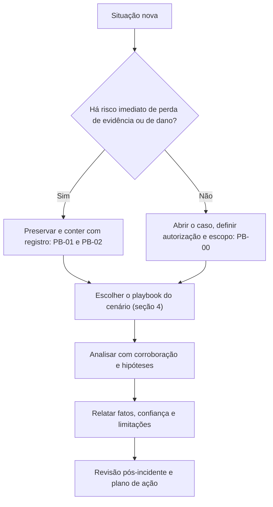

# Lições Consolidadas das Pastas 01 a 29

> **Objetivo pedagógico:** consolidar as lições centrais de todo o repositório em princípios transversais e em lições por tema, com a indicação da pasta e do playbook correspondentes, servindo como guia de revisão, de estudo e de consulta rápida, e identificar os erros mais frequentes que atravessam as áreas.

## 1. Os 25 princípios transversais

| # | Princípio | Onde aprofundar |
|---|---|---|
| 1 | **Autorização e base legal antes de acessar** conteúdo, dispositivos ou contas de pessoas | Pastas 01, 06 e 25; PB-00 e PB-14 |
| 2 | **Preservar antes de conter**, quando possível, e registrar o estado anterior antes de alterar | Pastas 03, 16 e 23; PB-01 e PB-02 |
| 3 | Seguir a **ordem de volatilidade** e priorizar as fontes de retenção curta | Pasta 03; PB-01 |
| 4 | **Hash e custódia** em toda evidência, desde a coleta | Pastas 02 e 04; PB-04 |
| 5 | Trabalhar sobre **cópias** e manter os originais em somente leitura | Pastas 03, 04 e 10 |
| 6 | **UTC e normalização de tempo**, com o desvio de relógio declarado | Pasta 05 |
| 7 | **Corroborar** cada achado importante com uma segunda fonte independente | Pastas 05, 11 e 22 |
| 8 | **Separar fatos, inferências e opiniões**, e declarar o grau de confiança | Pasta 22 |
| 9 | Considerar **hipóteses alternativas**, inclusive as inocentes | Pastas 20, 22 e 28 |
| 10 | **Declarar as limitações** (dados ausentes, compressão, não determinismo) | Pastas 22, 24, 25 e 27 |
| 11 | **Minimização e proporcionalidade** no tratamento de dados pessoais | Pastas 06, 14 e 25 |
| 12 | **Registros** (logs) são evidência: habilitar, centralizar, reter e proteger antes do incidente | Pastas 11, 17 a 19 |
| 13 | **Identidade** é o novo perímetro: MFA resistente a phishing, privilégio mínimo e monitoramento de sessões | Pastas 18 e 19; PB-31 |
| 14 | **Desativar, e não excluir**, credenciais e recursos comprometidos até preservar | Pastas 17 e 18; PB-30 |
| 15 | **Ações financeiras imediatas** em fraudes, em paralelo à análise | PB-32; pastas 12 e 27 |
| 16 | **Backups imutáveis, isolados e testados**; a recuperação começa pela identidade | Pasta 16; caso 1 |
| 17 | **Ferramentas validadas**, versões registradas e análises reproduzíveis | Pasta 29 |
| 18 | **Playbooks com donos, versões e testes**; automatizar o que informa e exigir aprovação para o que altera | Pasta 23 |
| 19 | **Modelos e dados de IA são ativos** com integridade e proveniência a verificar | Pasta 24 |
| 20 | **Registro de interações com IA** com contexto completo; a reexecução não substitui o original | Pasta 25 |
| 21 | **Agência excessiva** de agentes é a principal ampliadora de dano; privilégio mínimo e aprovação humana | Pasta 26 |
| 22 | **Proveniência primeiro** em mídias sintéticas; verificação independente para decisões de alto impacto | Pasta 27 |
| 23 | **Centrar a resposta na vítima** em conteúdo íntimo e assédio, com preservação mínima | Pasta 27 |
| 24 | **Comunicar com fatos e incertezas**, sem afirmações categóricas prematuras | Pastas 22 e 28 |
| 25 | **Aprender sem culpabilizar** e converter lições em ações verificadas | Pasta 30 |

## 2. Lições por tema

### 2.1 Fundamentos, custódia, coleta e integridade (pastas 01 a 04)

| Lição | Pasta |
|---|---|
| A forense é processo: planejar, preservar, analisar, relatar; cada passo precisa ser defensável | 01 |
| A cadeia de custódia contínua e documentada sustenta a validade da prova; lacunas devem ser declaradas | 02 |
| Em sistemas ligados, decidir entre isolar, manter ou desligar considera memória, criptografia de disco e criticidade | 03 |
| Chaves de recuperação de criptografia de disco devem ser obtidas antes de desligar | 03 |
| Hashes SHA-256 em arquivos e em manifestos permitem verificar integridade; algoritmos antigos servem apenas à compatibilidade | 04 |
| Minimize a coleta ao escopo autorizado | 03 |

### 2.2 Análise de sistemas (pastas 05 a 10)

| Lição | Pasta |
|---|---|
| A linha do tempo exige UTC, âncoras de tempo e corroboração; fusos e relógios divergentes enganam | 05 |
| Evidências digitais têm valor conforme integridade, autenticidade e contexto | 06 |
| No Windows, MFT, Prefetch, Amcache, registro e logs de eventos se complementam; nenhum artefato isolado basta | 07 |
| No Linux, logs, persistência (cron, serviços e chaves) e histórico de comandos são centrais | 08 |
| A memória é a fonte mais volátil e precisa ser capturada antes de desligar sistemas relevantes | 09 |
| Em SSDs, o TRIM reduz a recuperação de dados excluídos; use bloqueio de escrita e imagem em formato forense | 10 |

### 2.3 Logs, e-mail, rede, mobile e malware (pastas 11 a 15)

| Lição | Pasta |
|---|---|
| Logs só ajudam se estiverem habilitados, centralizados, íntegros e retidos; documente as lacunas | 11 |
| Preserve o e-mail original (`.eml`) antes de remover mensagens; SPF, DKIM e DMARC orientam a autenticidade | 12 |
| Em rede, fluxos, DNS e metadados respondem muitas perguntas mesmo com tráfego criptografado; respeite a privacidade | 13 |
| Em dispositivos móveis, não desligue, isole (bolsa de Faraday), respeite a lei e preserve energia; atenção à segurança de quem pode estar sob monitoramento | 14 |
| Analise arquivos suspeitos em ambiente isolado, nunca execute fora dele; consulte reputação por hash antes de enviar amostras | 15 |

### 2.4 Ransomware, nuvem e Microsoft 365 (pastas 16 a 19)

| Lição | Pasta |
|---|---|
| Em ransomware, preserve logs e memória, proteja backups e identidade, e planeje a recuperação pela identidade | 16 |
| A dupla extorsão exige avaliar a exfiltração e as obrigações legais, adotando o pior caso quando faltam evidências | 16, 28 |
| Em nuvem, os registros precisam estar habilitados antes; recursos efêmeros exigem preservação rápida | 17 |
| No Entra ID, exporte as quatro categorias de logs de entrada, revogue sessões, remova consentimentos e métodos suspeitos | 18 |
| No Microsoft 365, a auditoria unificada, o `MailItemsAccessed` e o licenciamento determinam o que se pode provar | 19 |
| Aplique retenção legal e eDiscovery com escopo definido e custódia | 19; PB-46 |

### 2.5 Caça, OSINT e relatórios (pastas 20 a 22)

| Lição | Pasta |
|---|---|
| A caça começa por hipóteses, usa telemetria adequada e termina em detecção e documentação | 20 |
| OSINT exige legalidade, proporcionalidade, preservação (WARC e ata notarial) e cautela na atribuição | 21 |
| O relatório serve ao leitor: separar fatos e inferências, declarar a confiança e respeitar o contraditório | 22 |

### 2.6 Playbooks (pasta 23)

| Lição | Pasta |
|---|---|
| Playbooks táticos curtos, com decisões objetivas e portões legais, funcionam sob pressão | 23 |
| Sem dono, versão, teste e cópia offline, o playbook falha na crise | 23 |
| Ações que alteram evidências ou sistemas exigem aprovação humana e preservação prévia, inclusive em automações | 23 |

### 2.7 IA: forense, prompts, incidentes com LLM e deepfakes (pastas 24 a 27)

| Lição | Pasta |
|---|---|
| Congele versões (modelo, dados, código, ambiente e configurações) antes de retreinar ou restaurar | 24, 26 |
| Trate artefatos de modelo como potencialmente executáveis; inspecione sem carregar, em ambiente isolado | 24 |
| Reconstrua decisões automatizadas com versão, entradas, saídas e supervisão, e declare o não determinismo | 24 |
| Preserve o contexto completo das interações (instruções, histórico, recuperação e ferramentas) | 25 |
| A autoria de um prompt não se prova pela conta nem pelo estilo; corrobore com outras fontes | 25 |
| Em agentes, corrobore o trace com os registros de auditoria dos sistemas de destino | 26 |
| Falhas de controle de acesso no índice de RAG e na memória causam vazamentos; verifique a linhagem e as permissões | 26 |
| Mídias sintéticas: proveniência, contexto e múltiplas linhas de evidência; use detectores como apoio | 27 |
| Verificação independente e dupla aprovação previnem fraudes por voz e por vídeo | 27 |
| Em conteúdo íntimo sintético, proteja a vítima, minimize a exposição e escale imediatamente quando houver crianças e adolescentes | 27 |

### 2.8 Casos e laboratório (pastas 28 e 29)

| Lição | Pasta |
|---|---|
| Casos reais combinam técnicas de várias áreas e decisões sob incerteza; avalie decisões com a informação da época | 28 |
| Incidentes públicos mostram padrões: credenciais e MFA, identidade, terceiros, logs e privilégios | 28 |
| O laboratório precisa de isolamento, de validação de ferramentas e de reprodutibilidade | 29 |
| Documente comandos, versões e hashes, para que outro analista reproduza a análise | 29 |

## 3. Os 20 erros mais frequentes (consolidados)

| # | Erro | Consequência | Prevenção |
|---|---|---|---|
| 1 | Acessar dados de pessoas sem autorização ou sem proporcionalidade | Prova ilícita e violação de privacidade | Portões legais (PB-00 e PB-14) |
| 2 | Conter antes de preservar | Perda de evidências | Ordem de volatilidade; estado anterior registrado |
| 3 | Desligar ou reiniciar sistemas sem avaliar memória e criptografia | Perda de dados voláteis e de acesso | PB-02 |
| 4 | Não calcular hashes nem registrar a custódia | Prova contestável | Hash e custódia desde a coleta |
| 5 | Trabalhar no original | Alteração da evidência | Cópias e somente leitura |
| 6 | Misturar fusos e horários | Cronologia errada | UTC e âncoras |
| 7 | Concluir sem corroboração | Conclusões frágeis | Segunda fonte independente |
| 8 | Não declarar limitações e confiança | Relatórios enganosos | Escala de confiança e seção de limitações |
| 9 | Ignorar hipóteses alternativas | Viés de confirmação | Matriz de hipóteses |
| 10 | Logs não habilitados, curtos ou não centralizados | Impossibilidade de reconstruir | Prontidão forense (pastas 11 e 17 a 19) |
| 11 | Excluir credenciais e recursos antes de preservar | Perda de rastreabilidade | Desativar e exportar o estado |
| 12 | Demorar nas ações financeiras em fraudes | Perdas evitáveis | Contenção imediata e verificação independente |
| 13 | MFA fraco e acessos legados | Acesso inicial fácil | MFA resistente a phishing e revisão de acessos |
| 14 | Backups acessíveis ao atacante | Impossibilidade de recuperar | Backups imutáveis e isolados |
| 15 | Playbooks sem dono, sem teste e sem cópia offline | Falha na crise | Governança de playbooks |
| 16 | Automação que altera sem preservar nem aprovação | Danos em escala | Classificação das ações e salvaguardas |
| 17 | Carregar modelos ou amostras não confiáveis fora de ambiente isolado | Execução de código malicioso | Ambiente isolado e inspeção estática |
| 18 | Tratar reexecução de prompt, estilo de texto ou detector como prova | Conclusões injustas | Preservar o original e corroborar |
| 19 | Permissões excessivas para agentes e aplicações de IA | Ampliação do dano | Privilégio mínimo e aprovação humana |
| 20 | Culpar pessoas em vez de analisar sistemas | Cultura de medo e perda de aprendizado | Revisão sem culpabilização e plano de ação verificado |

## 4. Mapa de consulta rápida por situação

| Situação | Comece por |
|---|---|
| "Acabou de chegar um alerta crítico" | PB-00, PB-01 e PB-02; pasta 03 |
| "Suspeita de ransomware" | PB-25; pasta 16; caso 1 |
| "E-mail suspeito ou fraude de pagamento" | PB-20 e PB-32; pastas 12 e 19; caso 2 |
| "Conta comprometida" | PB-31; pasta 18 |
| "Colaborador copiando dados" | PB-14 e PB-33; caso 3 |
| "Chave de nuvem exposta" | PB-30; pasta 17; caso 4 |
| "Assistente de IA agiu de forma inesperada" | PB-45; pastas 25 e 26; caso 5 |
| "Vídeo ou áudio suspeito" | PB-44; pasta 27 |
| "Preciso preservar para um litígio" | PB-46; pastas 06 e 19 |
| "Preciso montar um relatório" | Pasta 22 |
| "Preciso treinar a equipe" | Pastas 28 e 29 |

## 5. Como usar este arquivo

| Uso | Descrição |
|---|---|
| Revisão antes de uma prova ou de uma entrevista técnica | Releia os 25 princípios e os 20 erros |
| Onboarding de novos analistas | Leia a seção 4 e depois as pastas correspondentes |
| Checklist de qualidade de um relatório | Verifique os princípios 7 a 10 e 24 |
| Planejamento de exercícios | Escolha lições e erros como objetivos dos cenários (pasta 28) |
| Atualização do repositório | Revise as lições após cada nova pasta ou norma relevante |

## 6. Casos de uso corporativos

- Guia de bolso de princípios e de erros para equipes de DFIR, SOC, jurídico e conformidade.
- Material de integração de novos colaboradores.
- Base para auditorias internas de prontidão forense.

## 7. Normas e frameworks relevantes

- NIST SP 800-61 Rev. 3; NIST SP 800-86; ISO/IEC 27035; ISO/IEC 27037, 27041, 27042 e 27043; ISO 21043
- MITRE ATT&CK e ATLAS; OWASP Top 10 para LLM; NIST AI RMF 1.0 e NIST AI 600-1
- LGPD, arts. 6º, 20, 46 e 48; CPP, arts. 158-A a 158-F

## 8. Referências

- Pastas 01 a 29 deste repositório, e arquivos 1 a 5 desta pasta.
- Fontes normativas e técnicas indicadas em cada pasta.
