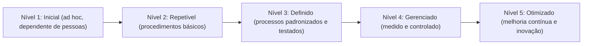

# Métricas, Indicadores e Maturidade da Capacidade Forense

> **Objetivo pedagógico:** medir o desempenho da resposta a incidentes e da capacidade forense com indicadores bem definidos (tempos de detecção, de contenção e de recuperação; qualidade das evidências; aderência a playbooks; cobertura de registros e de detecção; fechamento de lições), evitar armadilhas de medição, calcular indicadores a partir de um registro de incidentes e avaliar a maturidade com um modelo de cinco níveis em sete domínios, produzindo um plano de evolução.

## 1. Princípios de medição

| Princípio | Aplicação |
|---|---|
| Medir para decidir | Cada indicador deve apoiar uma decisão (investir, priorizar e corrigir) |
| Definição clara | Defina o início e o fim de cada intervalo, a fonte e o horário em UTC |
| Poucas métricas, bem escolhidas | Evite painéis com dezenas de números sem uso |
| Tendências, e não apenas valores | Compare períodos e acompanhe a dispersão |
| Mediana e percentis | Médias são distorcidas por casos extremos; use mediana e percentil 90 |
| Contexto | Número de incidentes, gravidade e complexidade alteram a interpretação |
| Cuidado com a Lei de Goodhart | Quando uma medida vira meta, deixa de ser boa medida (por exemplo, fechar incidentes rapidamente sem qualidade) |
| Qualidade antes de velocidade | Combine indicadores de tempo com indicadores de qualidade |

## 2. Indicadores de tempo

| Indicador | Definição (exemplo) | Observação |
|---|---|---|
| Tempo de permanência (dwell time) | Do início provável da atividade maliciosa à detecção | Depende de reconstrução; estimado |
| MTTD (tempo médio de detecção) | Do início provável à detecção | Use a mediana |
| Tempo de triagem | Do alerta ao início da análise | Mede a prontidão do SOC |
| MTTA (tempo de reconhecimento) | Do alerta ao primeiro reconhecimento por um analista | |
| MTTC (tempo de contenção) | Da detecção à contenção efetiva | |
| MTTR (tempo de recuperação) | Da detecção à restauração do serviço ou da operação normal | Defina o que significa "recuperado" |
| Tempo até a preservação | Da declaração do incidente à exportação e à proteção das fontes críticas | Indicador de qualidade forense |
| Tempo de notificação | Da ciência do incidente à comunicação legal exigida | Conformidade |

## 3. Indicadores de qualidade e de evidência

| Indicador | Definição |
|---|---|
| Completude da custódia | Percentual de evidências com formulário de custódia completo e hash |
| Evidências com hash e verificação | Percentual com hash calculado e verificado |
| Cobertura de logs | Percentual de sistemas críticos com logs centralizados e retenção adequada |
| Lacunas de registro por incidente | Quantidade de fontes necessárias que estavam ausentes ou expiradas |
| Revisão por pares | Percentual de relatórios revisados por um segundo analista |
| Retrabalho | Percentual de análises refeitas por erro ou por falta de dados |
| Conclusões com corroboração | Percentual de achados principais com segunda fonte independente |
| Validação de ferramentas | Percentual de ferramentas críticas com validação atualizada |

## 4. Indicadores de processo e de aprendizado

| Indicador | Definição |
|---|---|
| Aderência a playbooks | Percentual de passos críticos concluídos conforme o playbook |
| Cobertura de playbooks | Cenários prioritários com playbook testado, em relação ao total |
| Playbooks testados no período | Percentual com teste (leitura, mesa ou técnico) nos últimos 12 meses |
| Exercícios realizados | Número de exercícios de mesa e técnicos por semestre |
| Lições registradas e ações geradas | Contagem por incidente |
| Ações concluídas no prazo | Percentual de ações encerradas dentro do prazo |
| Ações verificadas | Percentual de ações com eficácia comprovada |
| Idade média das ações abertas | Dias desde a criação |
| Taxa de recorrência | Incidentes com causa já identificada em lição anterior |
| Cobertura de detecção | Técnicas ATT&CK priorizadas com detecção testada |

## 5. Cálculo a partir de um registro de incidentes (exemplo)

`registro_incidentes.csv` (dados fictícios):

```
id,gravidade,inicio_provavel_utc,detectado_utc,contido_utc,recuperado_utc,preservacao_ok_utc
INC-001,critica,2026-09-02 03:12:00,2026-09-15 02:50:00,2026-09-15 04:10:00,2026-09-21 12:00:00,2026-09-15 04:00:00
INC-002,alta,2026-10-05 12:44:00,2026-10-11 08:15:00,2026-10-11 10:00:00,2026-10-12 09:00:00,2026-10-11 09:10:00
INC-003,media,2026-10-08 20:00:00,2026-10-19 08:10:00,2026-10-19 12:00:00,2026-10-20 10:00:00,2026-10-19 11:30:00
INC-004,alta,2026-08-19 21:21:00,2026-08-20 08:20:00,2026-08-20 09:10:00,2026-08-22 09:00:00,2026-08-20 08:50:00
INC-005,alta,2026-10-21 07:55:00,2026-10-21 08:22:00,2026-10-21 08:30:00,2026-10-22 08:00:00,2026-10-21 08:40:00
```

```sql
-- DuckDB: indicadores por trimestre (medianas, em horas)
SELECT date_trunc('quarter', CAST(detectado_utc AS TIMESTAMP)) AS trimestre,
       count(*) AS incidentes,
       round(median(date_diff('minute', CAST(inicio_provavel_utc AS TIMESTAMP), CAST(detectado_utc AS TIMESTAMP))) / 60.0, 1) AS mttd_h,
       round(median(date_diff('minute', CAST(detectado_utc AS TIMESTAMP), CAST(contido_utc AS TIMESTAMP))) / 60.0, 1) AS mttc_h,
       round(median(date_diff('minute', CAST(detectado_utc AS TIMESTAMP), CAST(recuperado_utc AS TIMESTAMP))) / 60.0, 1) AS mttr_h,
       round(median(date_diff('minute', CAST(detectado_utc AS TIMESTAMP), CAST(preservacao_ok_utc AS TIMESTAMP))) / 60.0, 1) AS preservacao_h
FROM read_csv_auto('registro_incidentes.csv')
GROUP BY trimestre
ORDER BY trimestre;
```

Interprete com cautela: o início provável é uma **estimativa** (pode mudar com a investigação), e poucas observações geram números instáveis.

## 6. Armadilhas

| Armadilha | Consequência | Como evitar |
|---|---|---|
| Medir apenas velocidade | Incentiva fechamentos apressados | Combinar com qualidade e com recorrência |
| Metas rígidas de tempo | Manipulação do início ou do fim dos intervalos | Definições auditáveis e revisão |
| Comparar com outras organizações sem contexto | Conclusões enganosas | Comparar com a própria série histórica |
| Ignorar incidentes não detectados | Viés de sobrevivência | Complementar com exercícios e caça a ameaças |
| Painéis sem decisão associada | Medição sem uso | Ligar cada indicador a uma ação ou decisão |
| Dados inconsistentes | Indicadores sem credibilidade | Registro padronizado, horários em UTC e revisão |
| Reduzir pessoas a números | Cultura de medo | Indicadores de equipe e de sistema, não individuais |

## 7. Modelo de maturidade da capacidade forense (referência)

Este modelo é uma **referência didática deste repositório**, inspirado em modelos de maturidade de processos. Adapte-o à organização.



| Nível | Descrição geral |
|---|---|
| 1. Inicial | Respostas improvisadas; pouca documentação; preservação inconsistente; dependência de indivíduos |
| 2. Repetível | Procedimentos básicos para incidentes comuns; preservação e custódia praticadas, mas não padronizadas |
| 3. Definido | Processos, playbooks e papéis documentados e testados; ferramentas validadas; registro padronizado |
| 4. Gerenciado | Indicadores acompanhados; revisão por pares sistemática; ações verificadas; integração com riscos |
| 5. Otimizado | Melhoria contínua baseada em dados; detecção e playbooks atualizados por lições; inovação e compartilhamento |

### Domínios e critérios

| Domínio | Nível 1 | Nível 3 | Nível 5 |
|---|---|---|---|
| Governança e legal | Sem autoridade clara nem portões legais | Autoridade, portões legais e de privacidade padronizados e aplicados | Revisão contínua com Jurídico e DPO; aprendizado jurídico incorporado |
| Pessoas e competências | Dependência de poucas pessoas | Papéis definidos, treinamento e exercícios regulares | Programa de desenvolvimento, rodízio e mentoria |
| Processos e playbooks | Procedimentos informais | Catálogo de playbooks com donos, versões e testes | Playbooks atualizados por lições, com automação segura |
| Tecnologia e ferramentas | Ferramentas ad hoc | Ferramentas inventariadas, validadas e em versão controlada | Validação contínua, automação e engenharia de detecção integrada |
| Evidências e custódia | Preservação inconsistente | Hashes, custódia e armazenamento padronizados | Prontidão forense incorporada aos sistemas (registros e imutabilidade) |
| Registro e visibilidade | Logs dispersos e curtos | Centralização, retenção definida e cobertura medida | Cobertura de técnicas priorizadas e telemetria validada |
| IA e tecnologias emergentes | Sem inventário nem registro | Inventário de sistemas de IA, registro de interações e playbooks | Auditoria contínua, testes adversariais e governança integrada |

## 8. Autoavaliação (modelo)

| Domínio | Nível atual (1 a 5) | Evidências | Lacunas | Nível-alvo e prazo | Ações |
|---|---|---|---|---|---|
| Governança e legal | | | | | |
| Pessoas e competências | | | | | |
| Processos e playbooks | | | | | |
| Tecnologia e ferramentas | | | | | |
| Evidências e custódia | | | | | |
| Registro e visibilidade | | | | | |
| IA e tecnologias emergentes | | | | | |

Use **evidências** (documentos, registros, relatórios de exercícios e métricas) para sustentar a pontuação. Reavalie ao menos uma vez por ano e após mudanças relevantes.

## 9. Do resultado ao plano de evolução

| Passo | Descrição |
|---|---|
| 1 | Identificar os domínios com menor nível e maior risco para a organização |
| 2 | Definir o nível-alvo realista e o prazo (por exemplo, subir um nível em 12 meses nos domínios críticos) |
| 3 | Transformar as lacunas em ações SMART (arquivo 4) |
| 4 | Priorizar por risco e esforço |
| 5 | Acompanhar os indicadores e reavaliar |
| 6 | Apresentar à direção, com os riscos aceitos |

## 10. Mapeamento com referenciais

| Referencial | Relação |
|---|---|
| NIST CSF 2.0 | Perfis atual e alvo; níveis de implementação (Tiers) |
| ISO/IEC 27001:2022 | Avaliação do desempenho e melhoria (cláusulas 9 e 10) |
| ISO/IEC 27035 | Capacidade de gestão de incidentes |
| FIRST CSIRT Services Framework | Serviços e capacidades de uma equipe de resposta |
| ABNT NBR ISO/IEC 17025 | Qualidade de laboratórios (aplicável aos laboratórios forenses) |

## 11. Exemplo prático: avaliação de uma organização fictícia

| Domínio | Nível | Principal evidência | Principal lacuna | Ação prioritária |
|---|---|---|---|---|
| Governança e legal | 3 | Procedimento de portões legais aplicado em 5 casos | Sem revisão semestral com o Jurídico | Agendar revisão semestral |
| Processos e playbooks | 2 | 8 playbooks escritos, 2 testados | Sem donos nem datas de revisão | Atribuir donos; testar 6 playbooks em 6 meses |
| Evidências e custódia | 3 | Hashes e custódia em 90% dos casos | Armazenamento sem cópia testada | Teste trimestral de restauração |
| Registro e visibilidade | 2 | SIEM com logs de VPN e de domínio | Retenção de 90 dias; cobertura de EDR de 70% | Retenção de 12 meses e cobertura de 100% em servidores |
| IA e emergentes | 1 | Nenhum inventário de IA | Sem registro de interações com LLM | Inventário e especificação de registro (pasta 25) |

## 12. Casos de uso corporativos

- Painel de indicadores do SOC e do DFIR para a direção e para auditorias.
- Avaliação anual de maturidade e plano de evolução.
- Justificativa de investimentos com base em lacunas e em risco.

## 13. Normas e frameworks relevantes

- NIST CSF 2.0; NIST SP 800-61 Rev. 3; NIST SP 800-55 (medição de segurança da informação)
- ISO/IEC 27001:2022 (cláusula 9); ISO/IEC 27004 (monitoramento, medição, análise e avaliação); ISO/IEC 27035
- FIRST. CSIRT Services Framework; ABNT NBR ISO/IEC 17025

## 14. Referências

- Chew, E. et al. NIST SP 800-55 Vol. 1 e Vol. 2: Measurement Guide for Information Security.
- ISO/IEC 27004:2016. Information security management: Monitoring, measurement, analysis and evaluation.
- Goodhart, C. Problems of Monetary Management: The U.K. Experience. 1975 (origem da formulação).
- FIRST. CSIRT Services Framework (versão vigente).
- Pastas 22, 23, 28 e 29 deste repositório.
