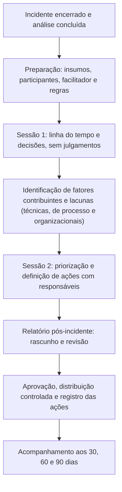

# Revisão Pós-Incidente: Método e Facilitação

> **Objetivo pedagógico:** conduzir uma revisão pós-incidente (post-incident review) estruturada, neutra e produtiva: preparar os insumos, convidar os participantes certos, facilitar a discussão sem culpabilização, revisar a linha do tempo e as decisões controlando o viés retrospectivo, identificar fatores contribuintes e lacunas de evidência, produzir o relatório pós-incidente (After Action Report) e o plano de ação, e adaptar o formato (hot wash e revisão formal) à gravidade do caso.

## 1. Formatos

| Formato | Duração | Quando | Produto |
|---|---|---|---|
| Hot wash | 30 a 45 minutos, até 48 horas após o encerramento | Todos os incidentes relevantes; logo depois de exercícios | Lista de impressões e de ações imediatas |
| Revisão formal | 90 a 120 minutos (pode ser em duas sessões) | Incidentes de gravidade média a crítica; quase-incidentes relevantes | Relatório pós-incidente e plano de ação |
| Revisão resumida | 30 minutos | Incidentes de baixa gravidade e quase-incidentes | Registro de lições e ações |
| Revisão de acompanhamento | 30 minutos, aos 30, 60 e 90 dias | Verificação das ações | Status e eficácia |
| Revisão de tendências | Trimestral ou anual | Conjunto de incidentes | Padrões e prioridades |

## 2. Fluxo da revisão formal

## 3. Preparação

| Item | Descrição |
|---|---|
| Insumos | Linha do tempo integrada, livro de decisões, relatório forense, SITREPs, métricas e registro de lacunas |
| Participantes | Quem atuou no incidente, responsáveis pelos sistemas, jurídico, DPO, conformidade e um representante do negócio |
| Facilitador | Pessoa neutra, com experiência em facilitação; idealmente não pertencente ao núcleo de resposta do incidente |
| Escriba | Registra a discussão e as ações |
| Local e canal | Ambiente confidencial; cuidados com gravação e com o registro de conteúdo sensível |
| Pré-leitura | Linha do tempo e perguntas, com antecedência |
| Autorização do Jurídico | Estrutura e escopo do documento (arquivo 1, seção 9) |
| Regras de condução | Divulgadas no início (seção 4) |

## 4. Regras de condução (para ler no início)

1. O objetivo é aprender e melhorar sistemas, e não identificar culpados.
2. Falamos de **decisões e condições**, e não de pessoas ("a decisão de desligar..." e não "fulano desligou...").
3. Julgamos as decisões com a informação disponível **na hora**.
4. Todas as vozes são importantes; quem atuou primeiro fala primeiro.
5. "Não sei" e "não tínhamos essa informação" são respostas válidas.
6. Registramos fatos e graus de confiança; opiniões são identificadas como tais.
7. O que é dito aqui é usado para melhorar, e não para disciplinar.
8. Cada lição precisa levar a uma ação com responsável e prazo, ou a uma decisão explícita de aceitar o risco.

## 5. Roteiro da sessão 1: linha do tempo e decisões

| Etapa | Duração (referência) | Condução |
|---|---|---|
| Abertura e regras | 5 min | Objetivo, regras e escopo |
| Resumo do incidente | 10 min | Líder do incidente apresenta o contexto e o desfecho |
| Revisão da linha do tempo | 25 min | Percorrer os marcos: o que se sabia, o que foi feito, o que estava disponível |
| Pontos de decisão | 25 min | Para cada decisão crítica: opções, informações, critérios e resultado |
| Lacunas e dificuldades | 15 min | Logs ausentes, ferramentas, acessos, comunicação, coordenação |
| Fechamento | 5 min | Itens para a sessão 2 |

### Perguntas-guia por tema

| Tema | Perguntas |
|---|---|
| Detecção | Como e quando soubemos? O que poderia ter alertado antes? Que sinais existiam e não foram vistos? |
| Preservação | O que foi preservado primeiro e por quê? O que se perdeu? Havia fontes de retenção curta não cobertas? |
| Decisões | Que alternativas existiam? Que informação estava disponível? Quem decidiu e com base em que critério? Faltou autoridade ou clareza de papéis? |
| Contenção e erradicação | A contenção preservou evidências? Houve efeitos colaterais? Como validamos a erradicação? |
| Coordenação e comunicação | Os canais funcionaram? Quem faltou na conversa? As mensagens a usuários, à direção e a terceiros foram claras? |
| Aspectos legais | Os portões de autorização e de privacidade foram atendidos? Os prazos de notificação foram identificados a tempo? |
| Ferramentas e acessos | Tínhamos os acessos e as ferramentas necessárias? O que atrasou? |
| Recuperação | A ordem de recuperação foi adequada? Os backups funcionaram? |
| Pessoas | Havia pessoas suficientes e preparadas? Houve sobrecarga? |
| O que funcionou | O que devemos manter e replicar? |

## 6. Controle do viés retrospectivo

| Armadilha | Como evitar |
|---|---|
| "Era óbvio" | Pergunte: "o que se via naquele momento?" e reconstrua o painel de informações da época |
| Julgar pelo resultado | Avalie a qualidade da decisão pelo processo e pela informação, e não apenas pelo desfecho |
| Culpar a última pessoa que tocou o sistema | Procure as condições que tornaram o erro possível |
| Explicações únicas | Busque múltiplos fatores contribuintes (arquivo 3) |
| Narrativas lineares demais | Reconheça a incerteza e as pressões do momento |
| Foco apenas no que falhou | Documente também o que funcionou |

## 7. Roteiro da sessão 2: fatores e ações

| Etapa | Descrição |
|---|---|
| 1. Síntese dos fatores contribuintes | Agrupar por categorias (técnicos, de processo, de pessoas e de organização, externos) |
| 2. Priorização | Avaliar impacto, probabilidade e esforço (arquivo 4) |
| 3. Definição de ações | Ações específicas, com responsável, prazo e verificação |
| 4. Aceitação de riscos | Itens que não serão tratados, com justificativa e aprovação do responsável pelo risco |
| 5. Comunicação | O que será compartilhado, com quem e como |
| 6. Fechamento | Revisão das ações e das datas de acompanhamento |

## 8. Relatório pós-incidente (After Action Report): estrutura

| Seção | Conteúdo |
|---|---|
| 1. Identificação | Caso, datas, classificação do incidente, participantes e autorização |
| 2. Resumo executivo | O que ocorreu, impacto e desfecho (1 página) |
| 3. Cronologia | Marcos principais, em UTC |
| 4. Detecção e resposta | Como o incidente foi detectado, contido, erradicado e recuperado |
| 5. Métricas | Tempo de detecção, de contenção e de recuperação; cobertura de evidências |
| 6. O que funcionou | Práticas a manter |
| 7. Fatores contribuintes e lacunas | Técnicos, de processo, de pessoas e de organização |
| 8. Lições aprendidas | Declaradas como lições, e não como observações soltas |
| 9. Plano de ação | Ação, responsável, prazo, verificação e prioridade |
| 10. Riscos aceitos | Itens sem ação, com justificativa |
| 11. Obrigações e comunicações | Notificações realizadas e pendentes |
| 12. Anexos | Linha do tempo detalhada, registro de decisões e referências |

## 9. Modelos

### 9.1 Agenda da revisão formal

| Horário | Item | Responsável |
|---|---|---|
| 00:00 | Abertura, objetivos e regras | Facilitador |
| 00:05 | Resumo do incidente | Líder do incidente |
| 00:15 | Linha do tempo e decisões | Facilitador e equipe |
| 00:55 | Lacunas e dificuldades | Facilitador |
| 01:10 | Intervalo | |
| 01:15 | Fatores contribuintes | Facilitador |
| 01:35 | Ações e prioridades | Facilitador e responsáveis |
| 01:55 | Fechamento e próximos passos | Facilitador |

### 9.2 Registro de lição aprendida

| Campo | Preenchimento |
|---|---|
| ID | LA-AAAA-NNN |
| Incidente ou exercício de origem | |
| Observação (fato) | |
| Lição | |
| Categoria (detecção, preservação, contenção, recuperação, jurídico, comunicação, pessoas ou ferramentas) | |
| Fatores contribuintes | |
| Ação proposta | |
| Responsável e prazo | |
| Verificação de eficácia | |
| Prioridade | |
| Status e data de conclusão | |

### 9.3 Formato de hot wash (30 minutos)

| Pergunta | Tempo |
|---|---|
| O que funcionou bem? | 8 min |
| O que nos atrapalhou? | 8 min |
| O que faríamos diferente? | 8 min |
| Qual a primeira ação imediata? | 6 min |

## 10. Dificuldades comuns e como tratá-las

| Dificuldade | Tratamento |
|---|---|
| Participantes defensivos | Reforçar as regras; usar a linguagem de sistemas; facilitador neutro |
| Dominância de pessoas seniores | Dar a palavra primeiro a quem atuou na linha de frente; anotações individuais antes da discussão |
| Revisão que vira lista de reclamações | Exigir que cada ponto leve a uma ação ou à aceitação de risco |
| Muitas ações | Priorizar; limitar o número de ações simultâneas |
| Falta de tempo após o incidente | Agendar logo no encerramento; manter a revisão curta, porém formal |
| Informação sensível | Controlar a distribuição; minimizar dados pessoais |
| Ausência de patrocinador | Escalar à direção; vincular ações a riscos e a prazos regulatórios |

## 11. Exemplo prático: revisão do caso 2 (BEC no Microsoft 365)

| Tema | Resultado da revisão |
|---|---|
| Detecção | Ocorreu 6 dias após o início, por ligação de fornecedor; faltavam alertas de regras de caixa e de consentimento de aplicativos |
| Preservação | Bem conduzida: logs exportados antes da contenção; lacuna: retenção de 30 dias do Entra ID |
| Decisão crítica | A ação financeira imediata recuperou R$ 187 mil: manter como prática padrão (PB-32) |
| Fatores | MFA sem resistência a phishing; processo de alteração de dados bancários sem verificação independente; consentimento de aplicativos sem governança |
| Ações | MFA resistente a phishing para funções sensíveis; verificação independente; alertas de regras e de consentimentos; ampliar retenção; exercício semestral |
| Riscos aceitos | Manter consentimento de usuário para aplicativos de baixo risco, com monitoramento (aprovado pelo responsável) |

## 12. Casos de uso corporativos

- Rotina de revisões pós-incidente com relatório padronizado e acompanhamento.
- Revisões após exercícios de mesa e de laboratório.
- Treinamento de facilitadores internos.

## 13. Normas e frameworks relevantes

- NIST SP 800-61 Rev. 3; NIST SP 800-84; ISO/IEC 27035-1; ISO/IEC 27002:2022 (5.27)
- CISA. Tabletop Exercise Packages (relatórios pós-ação)
- LGPD, arts. 6º, 46 e 50

## 14. Referências

- Allspaw, J. Blameless PostMortems and a Just Culture. Etsy Code as Craft, 2012.
- Beyer, B. et al. Site Reliability Engineering (capítulo sobre cultura de postmortem). 2016.
- Dekker, S. The Field Guide to Understanding "Human Error". 3. ed. CRC Press, 2014.
- Pastas 22, 23 e 28 deste repositório.
